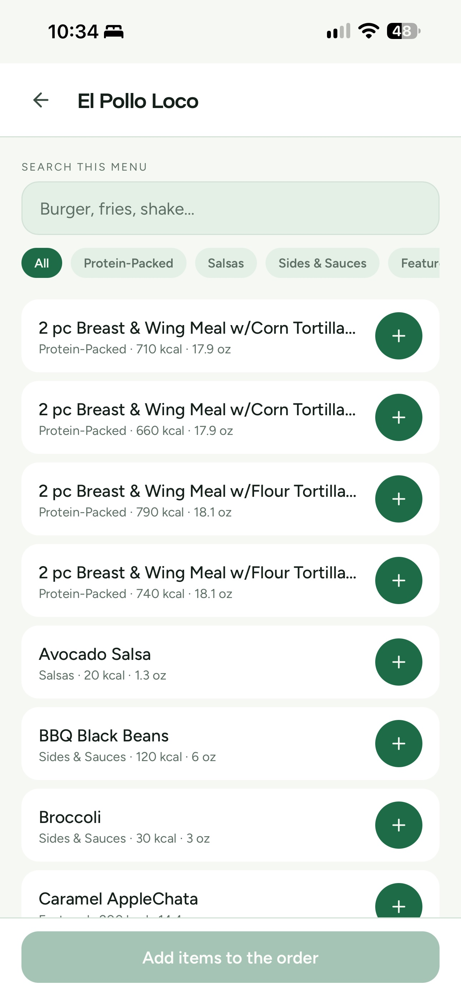
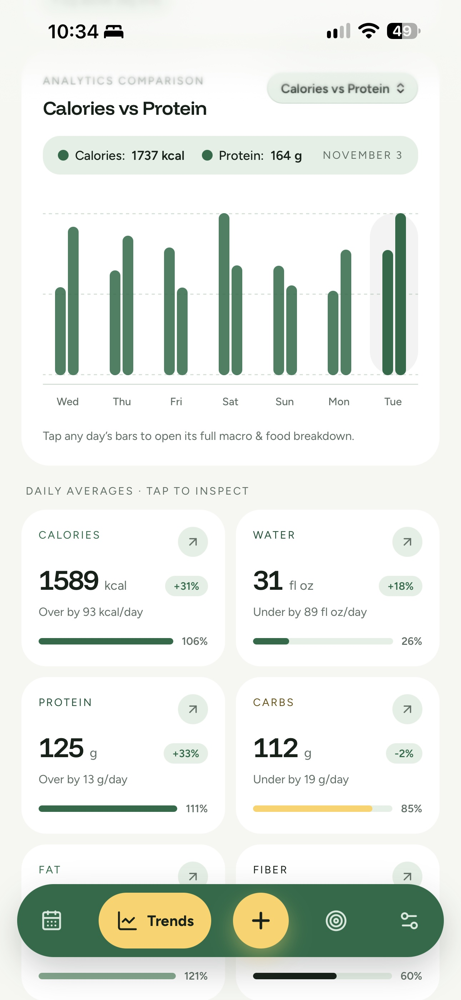

A few changes! I wanted to add some more data so I can calculate my macros for the week and for the month. This makes it more fluid and allows for some "cheat" days or "off" days where I don't hit my goals. 

Additionally, I created an API. This API reads my Supabase DB that holds some nutrtional information that I scraped from websites. Some data includes In-N-Out, Olive Garden, and McDonalds. This way, if I eat out, I can still track my macros easily within my app! This API is hosted on Render whereas the PWA is hosted on Azure Static Sites.

